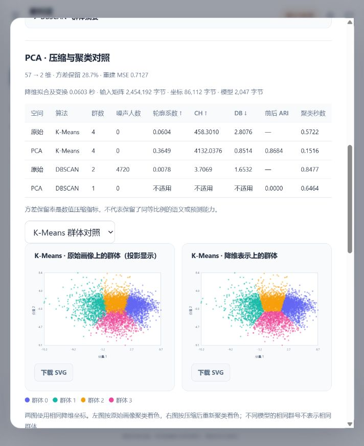

# 迭代二实际运行结果

运行日期：2026-10-19。以下数字来自完整净表上的实际模型训练与推断；不使用测试夹具或占位结果。

## 数据与版本

- 源码基线：仓库313b3bf，续作分支feat/iteration2-analysis。
- Hadoop任务：`20260923T144724Z-3509cc23`；数据版本：`clean-c91a5e196ca1af48c3da`。
- 净表SHA-256：`c91a5e196ca1af48c3dae9d2f5a6d66164fd222931ba7d954426eb02df811fa7`。
- 清洗规则SHA-256：`098d47649584249a346b438a75e239a2e54d4b22b74d66995264a4d28efdf471`，与该Hadoop任务自己的规则一致。
- T1：`2000-12-01T23:59:59Z`；T2：`2000-12-28T23:59:59Z`。
- 训练/验证/测试评分：797,116 / 100,886 / 98,111。
- 分类实验：`cls-2b75994cd5c52b8be269`；画像实验：`pref-8fda422dc1b3d382-11f03b01`。
- 画像实现SHA-256：`9e1e3ca0025a3a17846d78f3555a3cfd93dd55f777e0420becdff5741c3139cf`。

## 分类模型

| 算法 | 选定参数 | 验证F1 | 测试Accuracy | 测试Precision | 测试Recall | 测试F1 | 测试AUC | 测试Brier ↓ |
| --- | --- | ---: | ---: | ---: | ---: | ---: | ---: | ---: |
| logistic_regression | {'C': 0.1, 'max_iter': 250, 'tol': 0.001, 'scaler': 'StandardScaler'} | 0.726508 | 0.691523 | 0.688943 | 0.789706 | 0.735891 | 0.750408 | 0.200845 |
| decision_tree | {'max_depth': 10, 'min_samples_leaf': 30, 'random_state': 42} | 0.701909 | 0.687650 | 0.691283 | 0.769834 | 0.728447 | 0.746427 | 0.202780 |

标签为Rating>=4，阈值0.5。逻辑回归C候选为0.1/1/10，决策树深度为6/10/14；根据验证集选取后才评价测试集。两模型结果接近，不据此断言存在统计显著差异。

## 原始画像与降维聚类

合格用户 5,382 位，历史不足 730 位；默认配置`{"min_history": 5, "n_clusters": 4, "eps": 3.0, "min_samples": 10, "dimensions": 2, "retention": null}`。

| 空间 | 聚类算法 | 群数 | 噪声人数 | 轮廓系数 ↑ | CH ↑ | DB ↓ | 与原始ARI | 聚类秒数 |
| --- | --- | ---: | ---: | ---: | ---: | ---: | ---: | ---: |
| 原始 | kmeans | 4 | 0 | 0.060356 | 458.301022 | 2.807604 | 不适用 | 0.572179 |
| 原始 | dbscan | 2 | 4720 | 0.007843 | 3.706877 | 1.653195 | 不适用 | 0.847678 |
| pca | kmeans | 4 | 0 | 0.364857 | 4132.037558 | 0.851432 | 0.868355 | 0.151554 |
| pca | dbscan | 1 | 0 | 不适用 | 不适用 | 不适用 | 0.000000 | 0.646379 |
| truncated_svd | kmeans | 4 | 0 | 0.360371 | 3878.676318 | 0.864726 | 0.799872 | 0.175126 |
| truncated_svd | dbscan | 1 | 3 | 不适用 | 不适用 | 不适用 | -0.000956 | 0.772010 |

噪声点不参与三项内部评价；轮廓系数最多抽样1000人且固定随机种子42。降维后DBSCAN只有一个非噪声群体，内部指标不适用；原始画像DBSCAN有约87.7%噪声，覆盖率较低。压缩改变距离结构，相同eps的效果不能直接等同。

## 降维信息与资源

| 算法 | 输入/输出维数 | 方差保留 | 重建MSE | 拟合变换秒数 | 输入矩阵字节 | 坐标字节 | 模型字节 |
| --- | --- | ---: | ---: | ---: | ---: | ---: | ---: |
| pca | 57 / 2 | 0.287267 | 0.712733 | 0.060337 | 2454192 | 86112 | 2047 |
| truncated_svd | 57 / 2 | 0.240210 | 0.760614 | 0.068787 | 2454192 | 86112 | 1487 |

二维坐标的存储比57维数值矩阵减少约96.5%，同时也丢失了大量方差信息。聚类轮廓系数上升不代表信息完整或预测更准。时间是当前机器的实际测量，不是跨环境性能保证；字节数不是峰值内存。

## 90%方差阈值补充实跑

| 算法 | 实际维数 | 实际方差保留 | 实验版本 |
| --- | ---: | ---: | --- |
| pca | 27 | 0.901111 | `pref-0e95af075505855a-53ce9a65` |
| truncated_svd | 28 | 0.906238 | `pref-0e95af075505855a-53ce9a65` |

达到90%方差保留需要明显多于两维。该次模型与坐标独立保存；当前活动结果仍为默认二维实验，便于演示直接比较。

## 验证与尚未验证事项

- Python完整测试套件83项通过；新增/调整后的画像边界测试7项再次通过。JavaScript测试11项通过。
- 完整净表校验、两个分类模型真实训练、四种无监督算法真实拟合与坐标/群体持久化均已执行。
- 交付校验脚本会校验14份画像产物、两个分类模型并实际复算降维坐标和K-Means标签；成功记录在提交包内。
- 真实浏览器已检查聚类/降维面板、两组散点图、用户1历史不足、用户2216真实群体和999999未知ID；浏览器控制台无错误。
- 当前没有配置可用Responses模型密钥，真实云端模型的自然语言选工具与追问仍待小组配置后验收。模拟模型测试仅验证工具协议与控制流程。

